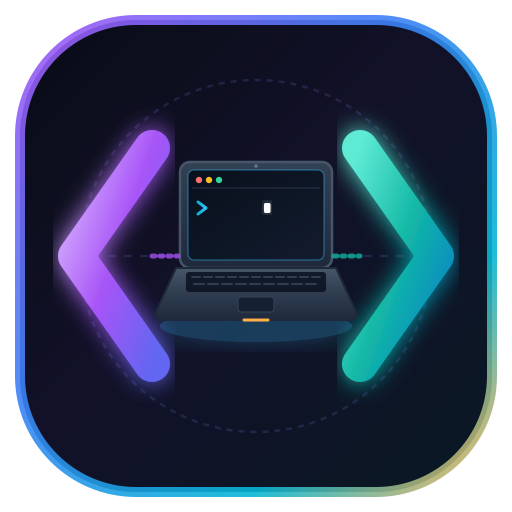

<div align="center">



# ⚡ ThinkCode Lab
### 100% Offline Multi-Language Code Playground & Mobile IDE for Students

> **Write, Compile & Execute Anywhere — Zero Latency, Zero Backend.**  
> Built for Computer Science and IT students to practice Python, PHP, Oracle SQL, JavaScript, HTML/CSS, and Linux Shell with true interactive runtime input directly on Web and Android.

[](https://thinkcode.infogalaxy.space/)
[](https://pyodide.org/)
[](https://github.com/seanmorris/php-wasm)
[](https://sql.js.org/)
[](https://capacitorjs.com/)
[](LICENSE)

<br>

[✨ Key Features](#-key-features) • [🧩 Supported Languages](#-supported-languages) • [🚀 Quick Start](#-quick-start) • [📱 Android App](#-android-app-apk) • [📂 Project Architecture](#-project-architecture) • [👤 Author](#-author) • [📄 License](#-license)

---

</div>

## 🌟 Why ThinkCode Lab?

Most online code playgrounds and cloud IDEs rely on remote backend servers to spin up Docker containers. While functional, they suffer from significant drawbacks for students:
- **Server Latency & Spin-up Delays:** 500ms to 2s wait times on every run.
- **Unreliable Connectivity:** Fails completely without stable internet access.
- **Pre-buffered Input Limitations:** Forcing students to provide all inputs in a text box before running code, destroying the natural flow of sequential `input()` prompts.
- **High Resource Requirements:** Heavy desktop IDEs (VS Code, PyCharm, Eclipse) overwhelm entry-level student laptops and budget smartphones.

**ThinkCode Lab** redefines the student coding experience by executing **100% client-side** using WebAssembly and isolated Web Workers.

| Feature | Generic Cloud Compilers | Standard Mobile Code Apps | ⚡ ThinkCode Lab |
| :--- | :---: | :---: | :---: |
| **Server Latency** | 500ms – 2s | N/A | **0ms (Instant Local WASM)** |
| **Offline Capability** | ❌ Requires Internet | ⚠️ Limited / Ad-supported | **✅ 100% Fully Offline** |
| **Interactive Terminal Input** | ❌ Pre-buffered Stdin | ⚠️ Often Broken | **✅ True Inline `input()` & `fgets(STDIN)`** |
| **Oracle SQL Simulation** | ❌ Standard SQLite only | ❌ None | **✅ Live Schemas + Oracle Dialect** |
| **Multi-Language Breadth** | Usually 1-2 | Usually 1 | **✅ 6 Runtimes (Python/PHP/SQL/JS/Web/Shell)** |
| **Native Android App** | ❌ Web-only | ⚠️ Heavy (>100 MB) | **✅ Ultra-lightweight APK (~12 MB)** |
| **Zero Backend Cost** | ❌ Expensive cloud | ⚠️ Ads / Subscriptions | **✅ Open-Source & Self-Contained** |

---

## ✨ Key Features

- **⚡ Instant 0ms Execution:** Code compiles and executes directly on the client CPU via WebAssembly.
- **⌨️ True In-Console Interactive Stdin:**
  - Python `input("Your name: ")` and PHP `fgets(STDIN)` run with real-time in-console stdin capture.
  - Prompts render directly inside the console with auto-resizing inline input fields.
  - Multi-prompt scripts execute sequentially without skipping or double-prompting.
- **🐘 Full-featured PHP 8.2 Engine & Dual-Section Practical Workspace:**
  - 100% offline WebAssembly build of PHP 8.2.11 (`php.wasm`).
  - **Dual-Section Split Editor:** Dedicated split workspace with Section 1 for HTML Form (`index.html`) and Section 2 for PHP script (`process.php`).
  - **3 View Modes:** `[ ⬍ Split ]`, `[ 🌐 HTML ]`, and `[ 🐘 PHP ]` with draggable resizer grip.
  - **Client-Side CGI Form Bridge:** Intercepts HTML form submissions, populates `$_POST` / `$_GET` / `$_REQUEST`, and updates the Preview window in real time.
  - **Pure PHP Script Execution:** Run standalone algorithms and console scripts with one-click `[ ▶ Run PHP ]` button.
  - CodeMirror 6 syntax highlighting via `@codemirror/lang-php` and `@codemirror/lang-html`.
- **🗄️ Oracle-Compatible SQL Lab:**
  - 4 Pre-seeded schemas: **SCOTT** (`EMP`, `DEPT`, `SALGRADE`, `BONUS`), **UNIVERSITY**, **BANK**, and **WORKSPACE**.
  - Oracle dialect compatibility: `NVL`, `NVL2`, `DECODE`, `INITCAP`, `LPAD`, `RPAD`, `TO_CHAR`, `TO_DATE`, `TRUNC`, `ADD_MONTHS`, `MONTHS_BETWEEN`, `LAST_DAY`, `LISTAGG`, `SYSDATE`, `DUAL`, `MINUS`, `ROWNUM`, sequences, and more.
  - Transaction control: `COMMIT`, `ROLLBACK`, `SAVEPOINT`, and `ROLLBACK TO`.
  - Built-in Schema Inspector, row count metrics, automatic DDL viewer, and 60+ preloaded practice queries.
- **🌐 HTML / CSS / JS Live Web Preview:** Sandboxed iframe preview with real-time DOM synchronization and console redirection.
- **🐧 Virtual Linux Bash Shell:** 35+ UNIX commands, pipelines (`|`), input/output redirections (`>`, `>>`, `<`), environment variables, and persistent virtual filesystem in `localStorage`.
- **🎨 Obsidian Dark Theme:** High-contrast cyber-styled interface with luminous glowing borders, syntax highlighting via CodeMirror 6, and a touch-friendly draggable split view.
- **📱 Standalone Native Android App:** Standalone offline APK packaged via Capacitor 6 with adaptive icons and splash screens.

---

## 🧩 Supported Languages & Runtimes

| Language | Runtime / Engine | Execution Environment | Key Capabilities |
| :--- | :--- | :--- | :--- |
| **Python 3.12** | Pyodide 0.26.4 (WASM) | Isolated Web Worker | Full stdlib, interactive `input()`, clean tracebacks |
| **PHP 8.2** | php-wasm (PHP 8.2.11 WASM) | Isolated Web Worker | Full OOP, arrays, associative maps, `fgets(STDIN)`, instant execution |
| **Oracle SQL** | sql.js (SQLite WASM) + Oracle Layer | Isolated Web Worker | SCOTT/UNIVERSITY schemas, transactions, Oracle functions |
| **JavaScript** | Modern ES2022+ Engine | Web Worker (`AsyncFunction`) | Intercepted console, touch-friendly `prompt()` & `alert()` modal |
| **HTML / CSS** | Sandboxed `<iframe>` | Main Thread DOM Preview | Live reload, DOM error forwarding, console sync |
| **Linux Shell** | Virtual Bash Emulator | Main Thread Engine | 35+ commands, virtual FS, pipes, redirects |
| **C / C++** | Clang WASI Toolchain | Planned (Phase 3) | Full STL, GCC/G++ compatible offline packs |
| **Java** | JVM WebAssembly | Planned (Phase 4) | Standard Java SE, OOP, Collections |

---

## 🚀 Quick Start

### Prerequisites
- [Node.js](https://nodejs.org/) v18.0.0 or higher
- Modern web browser (Chrome, Brave, Edge, Firefox, or Safari)

### 1. Clone & Install
```bash
# Clone the repository
git clone https://github.com/TahirMansuri/ThinkCode-Lab.git
cd ThinkCode-Lab

# Install dependencies
npm install
```

### 2. Run Local Development Server
```bash
npm run dev
```
Open [http://localhost:5173](http://localhost:5173) in your browser.

### 3. Build Production Bundle
```bash
npm run build
```
The optimized, offline-bundled static assets will be output to `dist/`.

---

## 📱 Android App (Release APK & AAB)

ThinkCode Lab compiles into a standalone, 100% offline production Android application (~16 MB) with all runtimes (Python, PHP, Oracle SQL) embedded directly:

```bash
# 1. Build and sync web assets to the Android platform
npm run build
npx cap sync android

# 2. Assemble signed production Release APK & Google Play Bundle
cd android
./gradlew assembleRelease bundleRelease
```

The compiled release artifacts:
- **Standalone Release APK (`v1.1.4` / `versionCode 6`):** `ThinkCodeLab-release.apk`
- **Google Play App Bundle (`v1.1.4` / `versionCode 6`):** `ThinkCodeLab-release.aab`
- **Target SDK:** API 36 (Android 15 / 16) | **Min SDK:** API 24 (Android 7.0+)
- **Google Play Store Status:** Submitted to Production track (in review).

---

## 📂 Project Architecture

```plaintext
ThinkCode-Studio/
├── android/                  # Native Android Capacitor wrapper & Gradle configs
├── public/                   # Static offline runtimes (Pyodide, fonts, icons)
│   ├── pyodide/              # Pyodide 0.26.4 WebAssembly & Python stdlib
│   └── assets/               # Brand SVGs, icons, and web fonts
├── scripts/
│   └── copy-runtimes.mjs     # Build script to copy offline WASM engines
├── src/
│   ├── engines/
│   │   ├── index.js          # Host WorkerEngine coordinator & SharedArrayBuffer I/O
│   │   ├── python.worker.js  # Pyodide CPython 3.12 worker with Atomics.wait stdin
│   │   ├── sql.worker.js     # sql.js SQLite worker + Oracle compatibility layer
│   │   ├── sql-seeds.js      # Relational schemas (SCOTT, UNIVERSITY, BANK)
│   │   ├── js.worker.js      # Isolated JavaScript Web Worker
│   │   └── shell.js          # In-browser virtual UNIX shell & virtual filesystem
│   ├── editor.js             # CodeMirror 6 editor instance & syntax configurations
│   ├── languages.js          # Language registry, icons, and code templates
│   ├── main.js               # Application state, UI event orchestrator & split pane
│   ├── shell-ui.js           # Virtual shell terminal renderer
│   ├── sql-data.js           # Practice query library & schema metadata
│   ├── sql-ui.js             # SQL table grid, schema inspector & DDL modals
│   └── styles.css            # Obsidian dark theme, luminous glow tokens & layout
├── capacitor.config.json     # Capacitor mobile app configuration
├── package.json              # Project scripts & npm dependencies
└── vite.config.js            # Vite build configuration with COOP/COEP headers
```

---

## 📖 Extended Documentation

- 📘 [Project Overview](PROJECT_OVERVIEW.md) — Educational motivation, problem statement, and vision.
- 🛠️ [Technical Stack & Architecture](TECH_STACK.md) — Deep dive into WASM engines, Atomics synchronization, and Capacitor.
- 📝 [Changelog & Milestones](CHANGELOG.md) — Detailed version history, bug fixes, and completed features.
- 🗺️ [Future Roadmap](ROADMAP.md) — Upcoming language engines (PHP, C/C++, Java), ER diagrams, and Play Store release.

---

## 👤 Author

<table style="border: none; background: transparent;">
  <tr>
    <td width="100px" align="center" valign="middle">
      
    </td>
    <td>
      <h3 style="margin: 0;">Tahir Mansuri</h3>
      <p style="margin: 4px 0; color: #58a6ff; font-weight: 600;">
        Lead System Engineer &amp; HOD, IMRD College
      </p>
      <p style="margin: 4px 0; color: #8b949e;">
        Creator of <b>ThinkCode Studio</b> &amp; <b>ThinkCode</b> • 8+ Years of Experience in IT, Systems Engineering, and Software Development
      </p>
      <p style="margin: 6px 0 0 0;">
        <a href="https://github.com/TahirMansuri">
          
        </a>
      </p>
    </td>
  </tr>
</table>

---

## 📄 License

Distributed under the **MIT License**. See [`LICENSE`](LICENSE) for more information.
