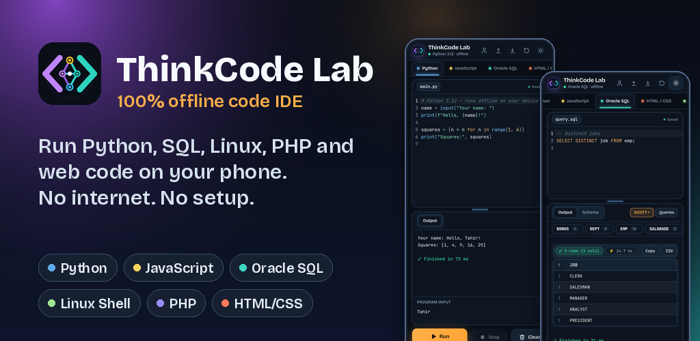
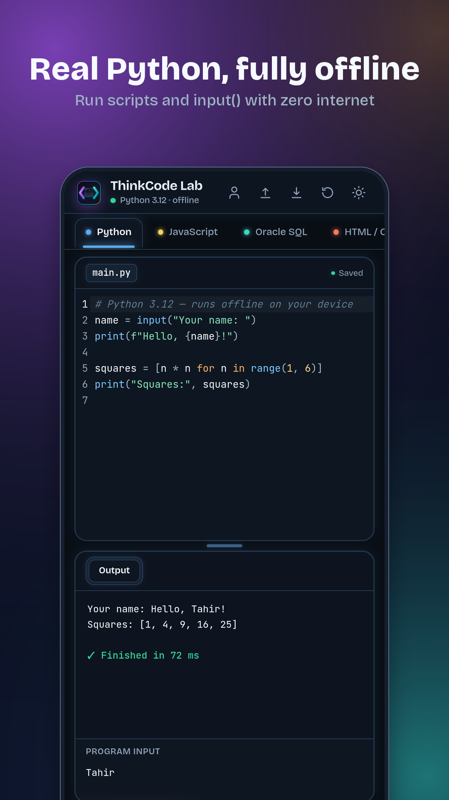
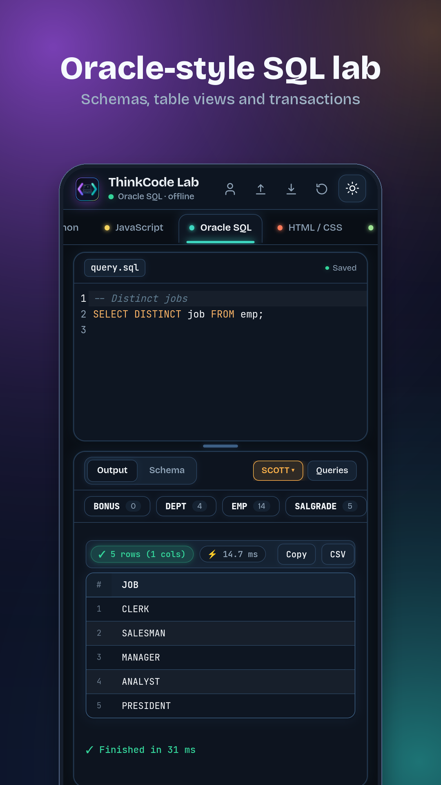
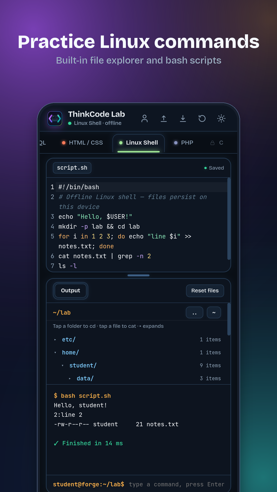
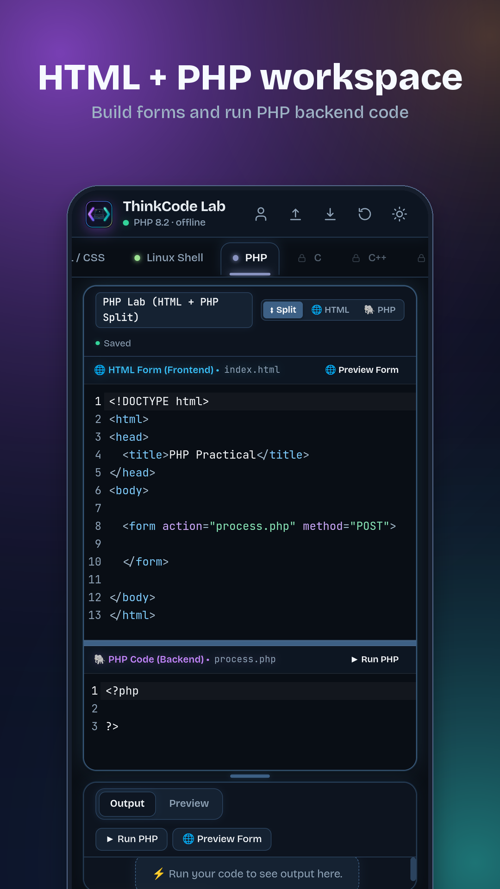
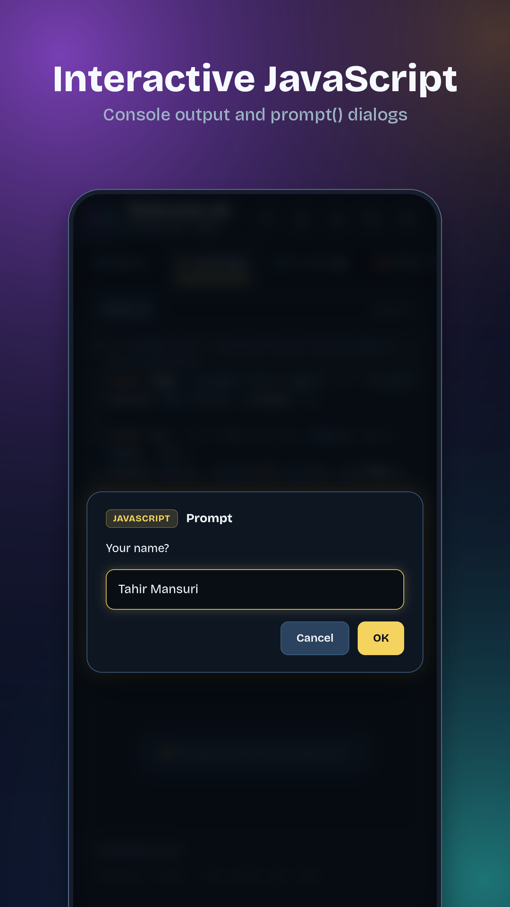
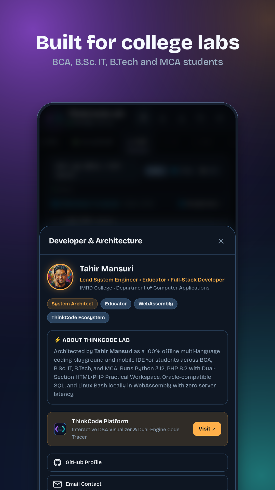
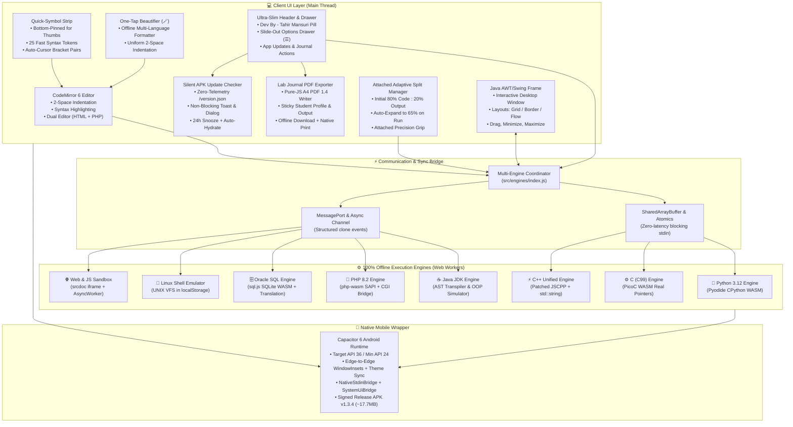

<div align="center">



# ⚡ ThinkCode Lab
### 100% Offline Multi-Language Code Playground & Mobile IDE for Students

> **Write, Compile & Execute Anywhere — Zero Latency, Zero Backend.**  
> Built by **Tahir Mansuri** for Computer Science and IT students to practice Java (with interactive AWT/Swing desktop windows), Python, C, C++, PHP, Oracle SQL, Linux Shell, JavaScript, and HTML/CSS directly on Web and Android.

[](https://thinkcode.infogalaxy.space/)
[](https://thinkcode-lab.web.app)
[-3DDC84?style=for-the-badge&logo=android&logoColor=white)](https://thinkcode-lab.web.app/download)
[](docs/04_CHANGELOG.md)
[](https://github.com/TahirMansuri)
[](LICENSE)

<br>

[✨ Key Features](#-key-features) • [📱 App Screenshots](#-app-screenshots--visual-tour) • [🏛️ System Architecture](#-system-architecture) • [🧩 Supported Languages](#-supported-languages-all-100-offline) • [📚 Syllabus Practicals](#-university-syllabus-practicals-library-78-assignments) • [🚀 Quick Start](#-quick-start) • [📱 Android Build](#-android-app-apk) • [📖 Documentation](#-complete-documentation-directory) • [👤 Author](#-author--leadership) • [📄 License](#-license)

---

</div>

## 🌟 Why ThinkCode Lab?

Most online code playgrounds and cloud IDEs rely on remote backend servers to spin up Docker containers. While functional, they suffer from significant drawbacks for students:
- **Server Latency & Spin-up Delays:** 500ms to 2s wait times on every run.
- **Unreliable Connectivity:** Fails completely without stable internet access.
- **Pre-buffered Input Limitations:** Forcing students to provide all inputs in a text box before running code, destroying the natural flow of sequential `input()` prompts.
- **Heavy Desktop IDE Requirements:** Heavy IDEs (VS Code, Android Studio, PyCharm, Eclipse) overwhelm student laptops and budget smartphones.

**ThinkCode Lab** redefines the student coding experience by executing **100% client-side** using WebAssembly and isolated Web Workers.

| Feature | Generic Cloud Compilers | Standard Mobile Code Apps | ⚡ ThinkCode Lab |
| :--- | :---: | :---: | :---: |
| **Server Latency** | 500ms – 2s | N/A | **0ms (Instant Local WASM)** |
| **Offline Capability** | ❌ Requires Internet | ⚠️ Limited / Ad-supported | **✅ 100% Fully Offline** |
| **Interactive Terminal Input** | ❌ Pre-buffered Stdin | ⚠️ Often Broken | **✅ True Sequential In-Console Input** |
| **Java Desktop Windows** | ❌ Headless / Text only | ❌ None | **✅ Simulated AWT/Swing Desktop Frame** |
| **Oracle SQL Simulation** | ❌ Standard SQLite only | ❌ None | **✅ Live Schemas + Oracle Dialect** |
| **PHP Form Practicals** | ❌ Requires Apache/XAMPP | ❌ None | **✅ Dual-Section Split Form Bridge** |
| **Mobile Symbol Strip** | ❌ Standard keyboard only | ⚠️ Clunky / Top-heavy | **✅ Bottom-Pinned (Direct Thumb Reach)** |
| **Code Beautifier / Formatter** | ⚠️ Online API or None | ❌ None | **✅ One-Tap Offline Formatter (🪄)** |
| **Mobile Screen Ergonomics** | ❌ Fixed desktop ports | ⚠️ Bulky headers & gaps | **✅ Attached Zero-Waste IDE + Slim Header** |
| **Lab Journal PDF Export** | ❌ Copy-paste to Word | ❌ None | **✅ 1-Tap Offline A4 Assignment PDF** |
| **In-App APK Updates** | ❌ Manual re-check | ❌ Stale sideloads | **✅ Silent `/version.json` Notifier** |
| **Multi-Language Breadth** | Usually 1-2 | Usually 1 | **✅ 8 Runtimes (Java/Python/C/C++/PHP/SQL/JS/Shell)** |
| **Native Android App** | ❌ Web-only | ⚠️ Heavy (>100 MB) | **✅ Ultra-compact APK (~17.7 MB)** |
| **Zero Backend Cost** | ❌ Expensive cloud | ⚠️ Ads / Subscriptions | **✅ Open-Source & Self-Contained** |

---

## 📱 App Screenshots & Visual Tour

<div align="center">

| 🐍 Python 3.12 (Interactive In-Console) | 🗄️ Oracle SQL (Dark Schema Inspector) | 🐧 Linux Shell (Virtual VFS & Pipes) |
| :---: | :---: | :---: |
|  |  |  |

| 🐘 PHP 8.2 (Dual HTML + PHP Split) | ⚡ Modern JS (Touch Modal Prompt) | 👤 About ThinkCode Lab (Tahir Mansuri) |
| :---: | :---: | :---: |
|  |  |  |

</div>

---

## 🏛️ System Architecture

ThinkCode Lab operates on a multi-threaded client architecture where the host UI coordinates with isolated Web Workers over zero-latency `SharedArrayBuffer` and `Atomics` memory bridges.



---

## ✨ Key Features

- **⚡ Instant 0ms Execution:** Code compiles and executes directly on the client device CPU via WebAssembly and Web Workers.
- **☕ Java AWT / Swing Desktop Window Emulation:**
  - Running GUI code like `JFrame`, `JLabel`, `JTextField`, `JPasswordField`, `JButton` renders an authentic interactive desktop window modal with title bar, minimize `—`, maximize `▢`, and close `✕` buttons.
  - Interactive layouts (`GridLayout`, `BorderLayout`, `FlowLayout`) and live event listeners.
- **📐 Adaptive Mobile Split Pane (80:20 ➔ 65:35):**
  - **Initial State:** 80% Code Editor : 20% Output for comfortable reading on mobile screens without scrolling.
  - **Auto-Expansion on Run:** Automatically animates output open to **65%** height upon clicking **Run**.
  - Reset to 80:20 on **Clear**, tab switch, practical selection, or template reset.
- **⌨️ True In-Console Interactive Stdin:**
  - Python `input()`, Java `Scanner`, C `scanf`, and C++ `cin >>` capture sequential input in real-time inside the console.
- **🐘 PHP 8.2 Dual-Section Form Workspace:**
  - Dual CodeMirror editors separating HTML Frontend (`index.html`) from PHP Backend (`process.php`) with 3 view modes (`Split`, `HTML`, `PHP`).
  - Client-side CGI bridge automatically populates `$_POST`, `$_GET`, `$_REQUEST` from HTML form submissions.
- **🗄️ Oracle-Compatible SQL Lab:**
  - 4 Pre-seeded schemas: **SCOTT** (`EMP`, `DEPT`, `SALGRADE`, `BONUS`), **UNIVERSITY**, **BANK**, and **WORKSPACE**.
  - Emulates Oracle functions: `NVL`, `NVL2`, `DECODE`, `INITCAP`, `LPAD`, `RPAD`, `TO_CHAR`, `TO_DATE`, `TRUNC`, `ADD_MONTHS`, `MONTHS_BETWEEN`, `LAST_DAY`, `LISTAGG`, `SYSDATE`, `DUAL`, `MINUS`, `ROWNUM <= n`.
  - Transaction control (`COMMIT`, `ROLLBACK`, `SAVEPOINT`) and 1-click **Export to CSV / TSV**.
- **🔍 Dual Compact Zoom Toolbars:**
  - Independent `A−` and `A+` zoom controls for both Code Editor and Output Console.
- **⌨️ Mobile Keyboard Quick-Symbol Strip:**
  - Pinned directly to the bottom of the code editor box, resting immediately above mobile virtual keyboards where thumbs naturally reach.
  - 25 high-frequency syntax tokens: `Tab`, `{ }`, `( )`, `[ ]`, `;`, `:`, `"`, `'`, `=`, `+`, `-`, `*`, `/`, `%`, `<`, `>`, `&`, `|`, `!`, `$`, `#`, `->`, `=>`, `//`, `_`.
  - Bracket pairs automatically place cursor inside, while `pointerdown` prevention stops soft keyboards from hiding during fast typing.
- **🪄 One-Tap Code Beautifier & Auto-Formatter:**
  - Zero-dependency client-side formatter (wand icon `🪄` or `Shift+Alt+F`) across all 8 languages: C, C++, Java, Python, PHP, SQL, HTML, and Shell.
  - Enforces uniform 2-space indentation, balances brackets, cleans up whitespace, and capitalizes Oracle SQL syntax.
  - Clean micro-toolbar fits `main.js`, `Practicals`, `🪄`, `A- A+`, and `Saved` onto a single row without wrapping.
- **📐 Attached High-Density IDE Layout:**
  - Language tab rail, editor box, 8px attached precision splitter divider, and output console form a seamless connected IDE with zero wasted card gaps or floating borders.
- **☰ Ultra-Slim 1-Line Header & Slide-Out Options Drawer:**
  - Collapses top controls into a clean bar with a slide-out drawer (`☰ Menu`) holding File Save/Open, **Export Lab Journal PDF**, Reset, Theme Toggle, **App Updates**, Share, and Developer info, freeing maximum vertical space for the active code editor.
- **📄 1-Tap Offline Lab Journal & Assignment A4 PDF Export (`src/lab-journal.js`):**
  - Generates print-ready multi-page A4 assignment PDFs 100% offline via an embedded Canvas 2D + pure-JS JPEG-in-PDF 1.4 writer (plus Android native `PrintManager` bridge).
  - Remembers student details (`Institute`, `Department`, `Name`, `Roll No.`, `Class`, `Year`), auto-infers subject & title, syntax-colors source code with line numbers, captures execution output / SQL tables / Swing frames, and renders a faculty signature footer.
- **🔔 Silent In-App APK Update Checker (`src/update-checker.js` + `/version.json`):**
  - Zero-telemetry HTTPS update manifest (`CORS` + `CORP` + `no-store`) informing sideloaded Android students of newer APK builds via non-blocking toast, menu dot badge, release-notes dialog, and 24-hour snooze, while dynamically hydrating **[thinkcode-lab.web.app/download](https://thinkcode-lab.web.app/download)**.
- **👤 Interactive Developer Profile Header Pill:**
  - Dedicated `Dev By - Tahir Mansuri` header pill opens the developer leadership bio and architecture modal with a single tap.
- **📏 Universal 2-Space Indentation:**
  - Clean 2-space tab indentation across all practical assignments and templates to prevent line wrapping on mobile.
- **📱 Standalone Native Android App:**
  - Built with Capacitor 6, targeting Android API 36 (`minSdkVersion 24`), Edge-to-Edge WindowInsets + dynamic Light/Dark bar contrast, `NativeStdinBridge`, and signed with production keystore.

---

## 🧩 Supported Languages (All 100% Offline)

| Language | Engine / Technology | Environment | Key Capabilities |
| :--- | :--- | :--- | :--- |
| **Java (JDK)** | AST Transpiler & Swing Runner | Web Worker | Classes, Overloading, Overriding, Interfaces, `try-catch-finally`, `Scanner`, AWT/Swing GUI Window Frame, simulated JDBC |
| **Python 3.12** | Pyodide 0.26.4 (CPython WASM) | Web Worker | Full stdlib, interactive in-console `input()`, clean tracebacks |
| **C (C99)** | PicoC WebAssembly (WASM) | Web Worker | Real pointers, `malloc`/`free`, `struct`, unions, arrays, `stdio.h`, interactive `scanf` |
| **C++** | Patched JSCPP Unified Pipeline | Web Worker | `std::string`, `iostream` (`cin`/`cout`), `<iomanip>`, `<cmath>`, classes, constructors, references, pointers, unions |
| **PHP 8.2** | php-wasm (PHP 8.2.11 WASM) | Web Worker | Dual-Section Split workspace, client-side CGI bridge (`$_POST`/`$_GET`), instant HTML preview |
| **Oracle SQL** | sql.js (SQLite WASM) + Oracle Layer | Web Worker | SCOTT/UNIVERSITY schemas, Oracle functions (`NVL`, `ROWNUM`, `SYSDATE`), transactions, CSV export |
| **Linux Shell** | Virtual UNIX Bash Emulator | Main Thread | 35+ commands, persistent virtual FS (`localStorage`), stream pipes (`\|`), redirections |
| **HTML / CSS** | Sandboxed `<iframe>` | Main Thread | Instant live preview, DOM error forwarding, console log capture |
| **JavaScript** | ES2022+ Engine | Web Worker | Modern async runtime, touch-friendly mobile `prompt()` & `alert()` modals |

---

## 📚 University Syllabus Practicals Library (78 Assignments)

ThinkCode Lab comes pre-loaded with **78 official university lab practicals** formatted with clean **2-space indentation** for instant 1-click loading:

| Subject / Course | Practical Count | Topics Covered |
| :--- | :---: | :--- |
| **Python (CA-214)** | **11** | Basic I/O, Conditions, Prime Range, Fibonacci, Matrix Addition, Functions & Recursion, Tuples/Sets, Dictionaries, OOP Class, File Handling, Inheritance |
| **Java (CA-313 / CA-315)** | **16** | Student Info, Switch Arithmetic, Array Largest, CLI Args, Scanner Input, Constructors, Overloading, Inheritance, Overriding, Interface Area, Strings, Exceptions, **AWT Calculator**, **Swing Login Form**, JDBC Connection, CRUD Operations |
| **C++ (CA-113 & CA-123)** | **17** | Arithmetic, Control Flow, Loops, Primes, Factorial, Fibonacci, 2D Matrix, Functions, Strings, Structs, Exam Tabulation, Default Args, Class, Constructors, Inheritance, Refrigerator App |
| **Linux Shell (CA-123)** | **10** | Commands Demo, Fibonacci, Time Greeting, Login Check, Factorial, Divisible by 7, Prime, Palindrome, Armstrong Number, Result Sheet Filtering |
| **Oracle SQL (CA-223)** | **8** | DDL Create Table, DML Insert/Update/Delete, WHERE & ORDER BY, Aggregate Functions & GROUP BY, Joins, Subqueries & Nested Queries, Views, Sequences |
| **HTML / Web-I (CA-115)** | **7** | Headings & Paragraphs, Formatting, Lists, Links & Images, Tables, Student Registration Form, Frameset & CSS |
| **JavaScript (CA-125)** | **4** | Dynamic Greetings, Factorial Calculation, Form Validation, Digital Clock & DOM |
| **C Programming** | **5** | Factorial, Pointers & Swapping, Array Search, Struct Student, Dynamic Memory (`malloc`/`free`) |

---

## 🚀 Quick Start

### Prerequisites
- [Node.js](https://nodejs.org/) v18.0.0 or higher
- Modern web browser (Chrome, Brave, Edge, Firefox, or Safari)

### 1. Clone & Install
```bash
git clone https://github.com/TahirMansuri/ThinkCode-Lab.git
cd ThinkCode-Lab

npm install
```

### 2. Run Local Development Server
```bash
npm run dev
```
Open [http://localhost:5173](http://localhost:5173) in your browser.

### 3. Run Automated Verification Suites
```bash
npm run test:ccpp                  # 47 checks: PicoC C99, unified JSCPP C++, SAB stdin, formatter
node scripts/test-journal.mjs      # 10 checks: Student Lab Journal & A4 PDF 1.4 structure
node scripts/test-update-checker.mjs # 10 checks: Semver, snooze, URL validation & version.json
```

### 4. Build Production Web Distribution
```bash
npm run build
```
Optimized static assets and WASM runtimes will be output to `dist/`.

### 5. Deploy Live to Firebase Hosting
```bash
npx firebase deploy --only hosting
```

---

## 📱 Android App (Release APK)

ThinkCode Lab compiles into a standalone, 100% offline native Android application (**v1.3.4 / Build 11**, ~17.7 MB) with all WASM runtimes embedded:

```bash
# 1. Build and sync web assets to Android
npm run build
npx cap sync android

# 2. Assemble signed production Release APK
cd android
./gradlew assembleRelease
```
- **Compiled Release APK:** `ThinkCodeLab-v1.3.4.apk` (Version Code `11`, ~17.7 MB)
- **Target API:** API 36 (Android 16) | **Min API:** API 24 (Android 7.0+)
- **Download Portal:** **[thinkcode-lab.web.app/download](https://thinkcode-lab.web.app/download)** (auto-hydrates from **[/version.json](https://thinkcode-lab.web.app/version.json)**; direct **[ThinkCodeLab-v1.3.4.apk](https://thinkcode-lab.web.app/ThinkCodeLab-v1.3.4.apk)**)

---

## 📖 Complete Documentation Directory

All technical architecture guides, engine specifications, changelogs, roadmaps, and developer memory files are systematically organized inside the [`docs/`](docs/) directory:

- 📘 [**docs/01_PROJECT_OVERVIEW.md**](docs/01_PROJECT_OVERVIEW.md) — Vision, problem statement, core value proposition, academic utilities, and repository structure.
- 🛠️ [**docs/02_TECH_STACK.md**](docs/02_TECH_STACK.md) — Technical architecture, threading model, `NativeStdinBridge`, `SystemUiBridge`, pure-JS PDF 1.4, and automated test suites.
- ⚙️ [**docs/03_ENGINE_ARCHITECTURE.md**](docs/03_ENGINE_ARCHITECTURE.md) — Deep dive into Java AST/Swing emulation, C/C++ PicoC/JSCPP, Clang upgrade path, PHP CGI bridge, Oracle SQL, Lab Journal PDF, and silent updater.
- 📝 [**docs/04_CHANGELOG.md**](docs/04_CHANGELOG.md) — Comprehensive version history from v1.0.0 through **v1.3.4 (Build 11 APK)** and active **`feature/v1.3.5`** enhancements.
- 🗺️ [**docs/05_ROADMAP.md**](docs/05_ROADMAP.md) — Completed phases 1–6, approved upcoming queue (#2 Saved Programs, #3 Classroom Auto-Graded Links, #5 Error Hints & Input Replay), and longer-term plans.
- 🚀 [**docs/06_PLAYSTORE_RELEASE.md**](docs/06_PLAYSTORE_RELEASE.md) — Keystore credentials, SHA-256 fingerprints & binary hashes, Play Protect appeal guide, `version.json` checklist, and Play Store details.
- 🧠 [**docs/07_DEVELOPER_MEMORY.md**](docs/07_DEVELOPER_MEMORY.md) — Developer memory, strictly enforced operational rules (Web-only deployment, no unrequested APK/VDI runs, backup policy), and technical gotchas learned.
- 🚀 [**docs/08_FUTURE_ENHANCEMENTS.md**](docs/08_FUTURE_ENHANCEMENTS.md) — Feature catalog tracking completed items (Quick-Symbol Strip, Beautifier, Drawer, Lab Journal PDF, Update Checker) and upcoming specifications.
- 🔐 [**docs/09_ACCOUNT_AND_DEPLOYMENT_INFO.md**](docs/09_ACCOUNT_AND_DEPLOYMENT_INFO.md) — Master reference for administrative accounts, Firebase configuration, `/version.json` rules, Android signing keystore, SHA-256 hashes, and deployment commands.

---

## 👤 Author & Leadership

<table style="border: none; background: transparent;">
  <tr>
    <td width="110px" align="center" valign="middle">
      
    </td>
    <td>
      <h3 style="margin: 0; color: #ffb04a;">Tahir Mansuri</h3>
      <p style="margin: 4px 0; color: #58a6ff; font-weight: 600;">
        Lead System Engineer &amp; HOD, IMRD College
      </p>
      <p style="margin: 4px 0; color: #c9d1d9;">
        Creator of <b>ThinkCode Lab</b> &amp; <b>ThinkCode</b> • 8+ Years of Experience in IT, Systems Engineering, Education, and Software Architecture.
      </p>
      <p style="margin: 6px 0 0 0;">
        <a href="https://github.com/TahirMansuri">
          
        </a>
        &nbsp;
        <a href="https://thinkcode.infogalaxy.space/">
          
        </a>
      </p>
    </td>
  </tr>
</table>

---

## 📄 License

Distributed under the **MIT License**. See [`LICENSE`](LICENSE) for more information.
